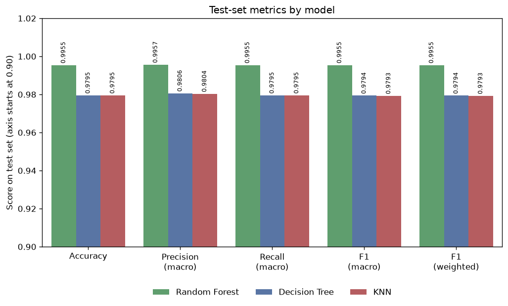

# 🌾 Crop Recommendation System (Machine Learning)

A machine-learning project that recommends the most suitable crop from **soil nutrients** (N, P, K, pH) and **climate** (temperature, humidity, rainfall). It compares three classifiers, selects the best one using actual test results, and serves it in an interactive **Streamlit** web app.

**Result:** **Random Forest** reaches **99.55 % test accuracy** (macro F1 0.9955) on 440 unseen samples, getting 2 of the 440 wrong.

---

## 1. Problem statement

Choosing the wrong crop for a field's soil and climate wastes water, fertiliser and money, and lowers yield. Farmers often decide from experience alone. Given seven measurable conditions, this project answers one question: **which of 22 crops best suits these conditions?** This is a **multi-class classification** problem.

## 2. Objectives

1. Explore and understand the dataset (EDA).
2. Preprocess the data without data leakage.
3. Train and compare a Decision Tree, a Random Forest and K-Nearest Neighbors (KNN).
4. Evaluate them with accuracy, precision, recall, F1, confusion matrices, cross-validation and an overfitting check.
5. Select the best model from actual results, using a fixed rule.
6. Deploy it in a beginner-friendly Streamlit app with input validation.
7. Verify everything with automated tests.

## 3. Dataset

File: `data/Crop_recommendation.csv`. It has 2,200 rows and 8 columns, with no missing values or duplicates. There are 22 crops with exactly 100 samples each, so the classes are balanced.

| Feature | Meaning | Unit | Range in data |
|---|---|---|---|
| `N` | Nitrogen content in soil | ratio | 0 – 140 |
| `P` | Phosphorus content in soil | ratio | 5 – 145 |
| `K` | Potassium content in soil | ratio | 5 – 205 |
| `temperature` | Air temperature | °C | 8.8 – 43.7 |
| `humidity` | Relative humidity | % | 14.3 – 99.98 |
| `ph` | Soil pH | 0–14 | 3.5 – 9.9 |
| `rainfall` | Rainfall | mm | 20.2 – 298.6 |
| `label` | **Target**: crop name | text | 22 crops |

**Crops:** apple, banana, blackgram, chickpea, coconut, coffee, cotton, grapes, jute, kidneybeans, lentil, maize, mango, mothbeans, mungbean, muskmelon, orange, papaya, pigeonpeas, pomegranate, rice, watermelon.

The original CSV is never modified. Its SHA-256 fingerprint is checked by a test.

## 4. Architecture and workflow

```
data/Crop_recommendation.csv
        │
        ▼
[EDA]  notebooks/exploratory_analysis.ipynb ──► results/eda_report.md, figures 01–09
        │
        ▼
[Preprocess]  src/data_preprocessing.py
   separate X / y → encode labels → stratified 80/20 split (random_state=42)
   → StandardScaler fitted on TRAIN only
   ──► data/processed/*.csv, models/scaler.joblib, models/label_encoder.joblib
        │
        ▼
[Train]  src/train.py
   Decision Tree, Random Forest (unscaled) · KNN (scaled)
   ──► models/*.joblib, results/metrics/training_results.*, figure 10
        │
        ▼
[Evaluate]  src/evaluate.py
   test metrics · 5-fold CV · overfitting check · best-model selection
   ──► models/best_model.json, results/metrics/*, figures 11–17, results/evaluation_report.md
        │
        ▼
[Predict]  src/predict.py  (validation + same preprocessing + saved best model)
        │
        ▼
[App]  app.py  (Streamlit)
```

Every module imports the feature list, paths and settings from `src/data_preprocessing.py`, and the model list from `src/train.py`. This means training, evaluation, prediction and the app always use the **same feature order and the same preprocessing**.

## 5. Key EDA findings

Full report: [results/eda_report.md](results/eda_report.md).

- The data is **clean**: no missing values, duplicates, impossible values or label typos.
- It is **perfectly balanced**: 100 samples per crop, so accuracy is a fair metric.
- **Outliers are real crop traits, not errors.** All K outliers are apple and grapes (K ≈ 200), and rainfall outliers are mostly rice. They were kept.
- Only **P and K** are strongly correlated (r = 0.74). No feature was dropped.
- Feature strength (eta², the share of each feature's variation explained by the crop): K 1.00, humidity 0.97, P 0.95, N 0.90, rainfall 0.85, temperature 0.50, pH 0.37.
- Features use very different scales, so scaling is needed for KNN.
- Values form neat blocks per crop, so the dataset is **likely synthetic or augmented**. Expect very high scores.

## 6. Preprocessing

| Step | Decision | Why |
|---|---|---|
| Features / target | 7 features in a fixed order; target `label` | Same order everywhere prevents silent mistakes |
| Label encoding | `LabelEncoder` (apple → 0 … watermelon → 21), saved | Models need numbers; the encoder turns predictions back into names |
| Split | 80/20, `stratify=label`, `random_state=42` → 1,760 / 440 rows | Every crop keeps exactly 80 train and 20 test rows, and the split is reproducible |
| Scaling | `StandardScaler` **fitted on training data only**, saved | Prevents data leakage. KNN uses distances, so features need equal scales |
| Scaled and unscaled | Both kept in `data/processed/` | Trees use unscaled data (scaling doesn't change their splits); KNN uses scaled data |
| Outliers | Kept | They are genuine characteristics of specific crops |

## 7. Algorithms

| Model | How it works (simple) | Input | Settings |
|---|---|---|---|
| **Decision Tree** | A flowchart of yes/no questions, such as "K > 150?" | unscaled | default, `random_state=42` |
| **Random Forest** | 100 trees, each trained on a random sample of rows and features; majority vote | unscaled | 100 trees, `random_state=42` |
| **KNN** | Finds the 5 most similar training samples and takes their majority crop | scaled | `n_neighbors=5` |

## 8. Evaluation results (actual)

All models were trained on the same 1,760 rows and tested on the same 440 unseen rows. Full report: [results/evaluation_report.md](results/evaluation_report.md).

| Rank | Model | Test accuracy | Precision (macro) | Recall (macro) | F1 (macro) | F1 (weighted) | Errors / 440 |
|---|---|---|---|---|---|---|---|
| 1 | **Random Forest** | **0.9955** | **0.9957** | **0.9955** | **0.9955** | **0.9955** | **2** |
| 2 | Decision Tree | 0.9795 | 0.9806 | 0.9795 | 0.9794 | 0.9794 | 9 |
| 3 | KNN | 0.9795 | 0.9804 | 0.9795 | 0.9793 | 0.9793 | 9 |

**Overfitting check** (gap = train accuracy − test accuracy; a gap above 0.02 is flagged):

| Model | Train acc. | 5-fold CV acc. (train set) | Test acc. | Gap | Verdict |
|---|---|---|---|---|---|
| Random Forest | 1.0000 | 0.9938 ± 0.0061 | 0.9955 | +0.0045 | OK |
| Decision Tree | 1.0000 | 0.9852 ± 0.0068 | 0.9795 | +0.0205 | slight overfitting |
| KNN | 0.9847 | 0.9653 ± 0.0121 | 0.9795 | +0.0051 | OK |

Speed (median of 5 runs; varies slightly per run):

| Model | Training (1,760 rows) | Predicting the 440 test rows |
|---|---|---|
| Decision Tree | about 14 ms | about 1 ms |
| Random Forest | about 0.4 s | about 14 ms |
| KNN | about 3–5 ms | about 5 ms |

Random Forest's only 2 mistakes were rice → jute and blackgram → maize. Those crops have overlapping conditions.

### Why Random Forest was selected

The selection rule is fixed in code (`src/evaluate.py`): highest **test macro F1**, then highest cross-validation accuracy, then smallest train–test gap, then fastest prediction.

- It has the highest macro F1 (0.9955) and makes 7 fewer mistakes than the other two models.
- Its cross-validation accuracy (0.9938) is also the highest, so the result is stable and not a lucky split.
- It has the smallest generalization gap (+0.0045). Averaging 100 trees cancels out the overfitting of single trees.
- It gives meaningful confidence scores (the share of trees voting for each crop) and top-3 alternatives.



## 9. Project structure

```
Crop-Recommendation-ML/
├── app.py                         # Streamlit web application
├── requirements.txt               # Python dependencies
├── README.md
├── .gitignore
├── data/
│   ├── Crop_recommendation.csv    # original dataset (never modified)
│   └── processed/                 # train/test split, scaled + unscaled (generated)
├── notebooks/
│   └── exploratory_analysis.ipynb # EDA with explanations
├── src/
│   ├── data_preprocessing.py      # Phase 3: split, encode, scale, shared settings
│   ├── train.py                   # Phase 4: train + save 3 models
│   ├── evaluate.py                # Phase 5: metrics, charts, best-model selection, report
│   └── predict.py                 # Phase 6: validated prediction pipeline + CLI
├── models/                        # saved models, scaler, encoder, best_model.json (generated)
├── results/
│   ├── eda_report.md
│   ├── evaluation_report.md       # generated by src/evaluate.py
│   ├── figures/                   # 01–09 EDA, 10 training, 11–17 evaluation
│   └── metrics/                   # JSON/CSV metrics, reports, confusion matrices
└── tests/                         # unittest suite (preprocessing, models, prediction, app)
```

## 10. Installation (Windows PowerShell)

Requirements: Python 3.12 or newer (developed with 3.14).

```powershell
cd "path\to\Crop-Recommendation-ML"

# Create the virtual environment (skip if .venv already exists)
python -m venv .venv

# Activate it
.\.venv\Scripts\Activate.ps1
# If PowerShell blocks the script, run this once, then activate again:
#   Set-ExecutionPolicy -Scope CurrentUser RemoteSigned

pip install -r requirements.txt
```

## 11. How to run the project

Run all commands from the project folder with the virtual environment activated.

The trained models (`models/`) and results (`results/`) are part of the project, so you can go straight to step 5 and run the app. `data/processed/` is not stored in git. After a fresh clone, run step 1 before running the tests or the evaluation again. Steps 1–3 rebuild everything from scratch and give the same metrics; only the timings differ slightly.

```powershell
# 1. Preprocess: split, encode, scale -> data/processed/, models/scaler.joblib, models/label_encoder.joblib
python -m src.data_preprocessing

# 2. Train the 3 models -> models/*.joblib, results/metrics/training_results.*
python -m src.train

# 3. Evaluate, select the best model, write the charts and results/evaluation_report.md
python -m src.evaluate

# 4. Predict from the command line
python -m src.predict --N 90 --P 42 --K 43 --temperature 20.9 --humidity 82 --ph 6.5 --rainfall 203

# 5. Launch the web app (opens http://localhost:8501)
streamlit run app.py

# 6. Run the test suite
python -m unittest discover -s tests -t . -v
```

To open the EDA notebook: `jupyter notebook notebooks/exploratory_analysis.ipynb`.

Always run modules with `python -m src.<name>` from the project folder, not `python src/<name>.py`, so the `src` imports work.

## 12. The web app

`streamlit run app.py` opens an app with five pages:

| Page | Content |
|---|---|
| 🏠 **Home** | Project introduction, dataset numbers, selected model and its test metrics |
| 🌱 **Prediction** | 7 inputs with help text, a "load typical example" helper, validation messages, the recommended crop, top-3 crops with confidence, and warnings for values outside the training range |
| 📊 **Model Performance** | Actual metric table, comparison charts, overfitting check, confusion matrices and per-crop F1 |
| 🔎 **EDA & Dataset** | Feature table, sample rows, key findings and all EDA charts |
| ℹ️ **About** | Objective, methodology, algorithms, technologies, limitations and future work |

**Input validation**
- *Errors*, where no prediction is made: missing values, non-numbers, and impossible values (negative nutrients, humidity outside 0–100 %, pH outside 0–14, temperature outside −20 to 60 °C).
- *Warnings*, where the prediction is still shown: values that are possible but outside the range seen in training. The model is less reliable there.

**Confidence:** the percentage is the share of the 100 trees that voted for each crop. It shows how much the model agrees with itself, **not a guarantee** that the crop will succeed.

## 13. Testing

64 automated tests (`unittest`, standard library) cover:

- **Preprocessing:** dataset unchanged, split shapes, no train/test overlap, 80/20 per crop, reproducible split, feature order, label encoding round trip.
- **Leakage and scaling:** scaler statistics equal training statistics only, saved scaled data equals scaler output, scaling by column name, and every model saw only the 1,760 training rows.
- **Models and metrics:** all artifacts load, saved metrics equal recomputed metrics, macro F1 recomputed by hand from the confusion matrices, generalization gap, best model follows the rule.
- **Prediction:** normal inputs, boundary values (exactly at the limits and just outside), missing / blank / non-numeric / NaN / inf / boolean / unknown inputs, all errors reported at once, out-of-range warnings, key-order independence, single vs batch agreement, pipeline accuracy equals the evaluation accuracy, missing or mismatched artifacts, and the command line.
- **App** (Streamlit `AppTest`): every page renders without errors, a valid prediction works, missing and invalid inputs show errors, out-of-range inputs show a warning, and the example loader works.

```powershell
python -m unittest discover -s tests -t . -v
```

## 14. Limitations

- **Likely synthetic data.** Crops form clean, separate blocks, which explains the near-perfect scores. Real farm measurements are noisier, so real-world accuracy will be lower.
- **Small dataset:** 2,200 rows with only 100 per crop.
- **Limited scope.** The model knows only 22 crops and 7 features. It ignores soil type, season, region, irrigation, pests and market prices.
- **No hyperparameter tuning.** Default settings were used, which was enough here.
- **Confidence scores** are vote shares, not calibrated probabilities of success.

## 15. Future scope

- Validate on real field data from local agricultural sources.
- Add features such as soil type, season and region, and tune hyperparameters with cross-validation.
- Explain each prediction with feature importance or SHAP values.
- Fetch weather data automatically from a weather API using the user's location.
- Deploy online (for example on Streamlit Community Cloud) and add local language support.

## 16. Technologies

Python 3.14 · pandas · NumPy · scikit-learn · matplotlib · seaborn · joblib · Jupyter · Streamlit
