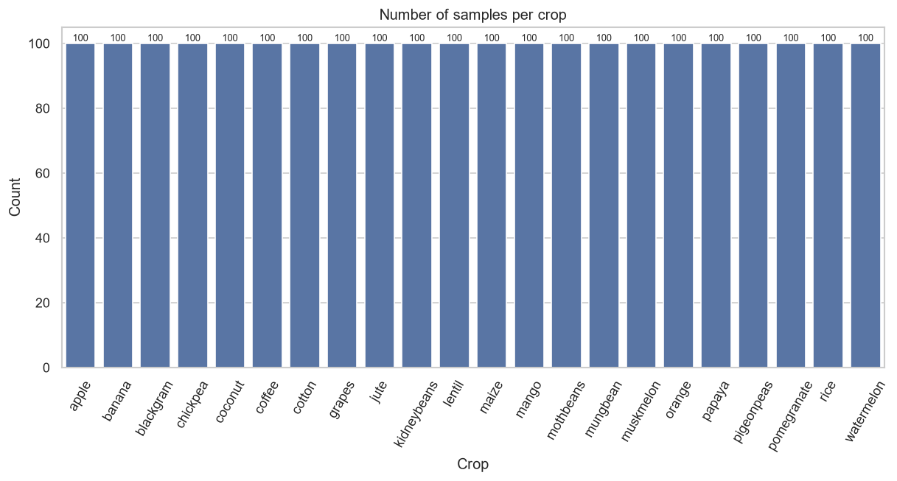
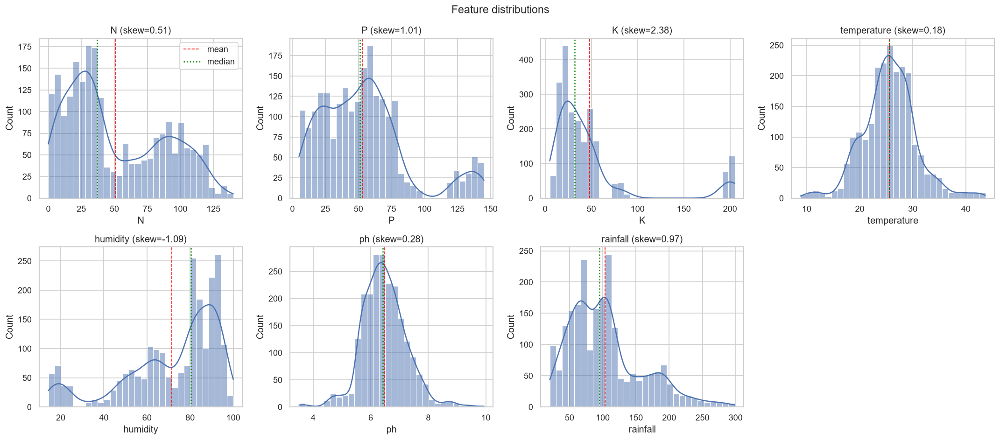
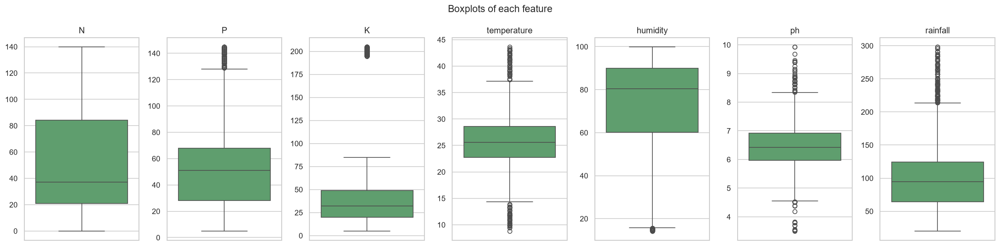
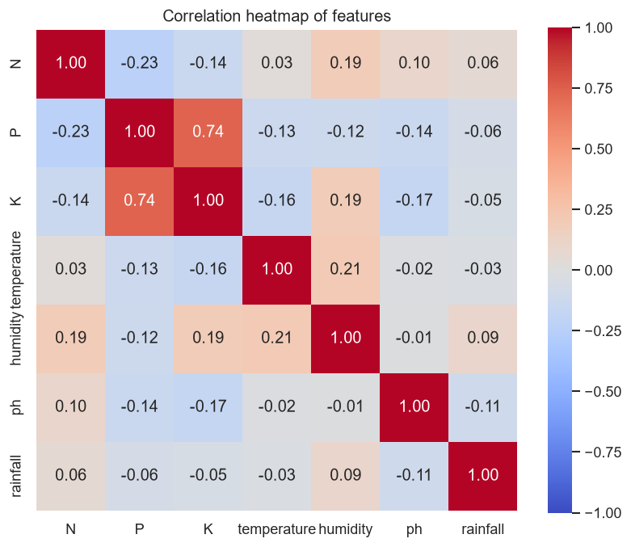
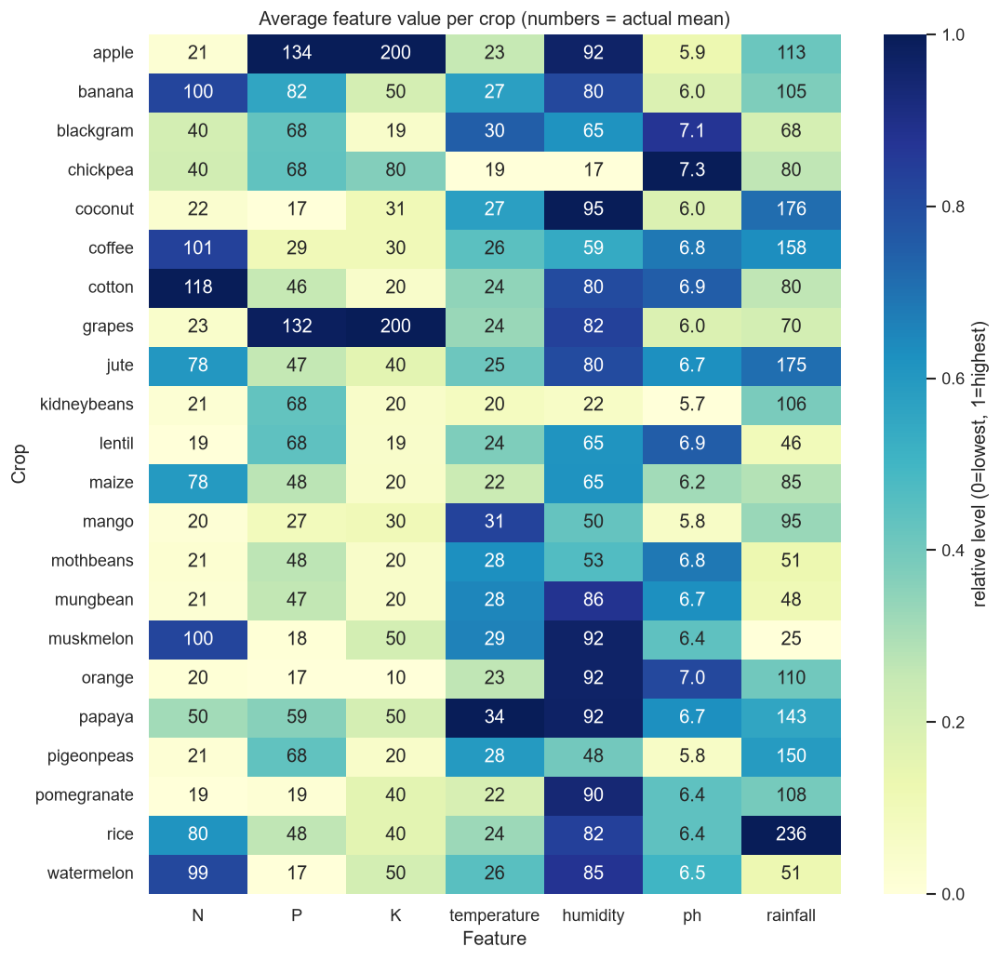
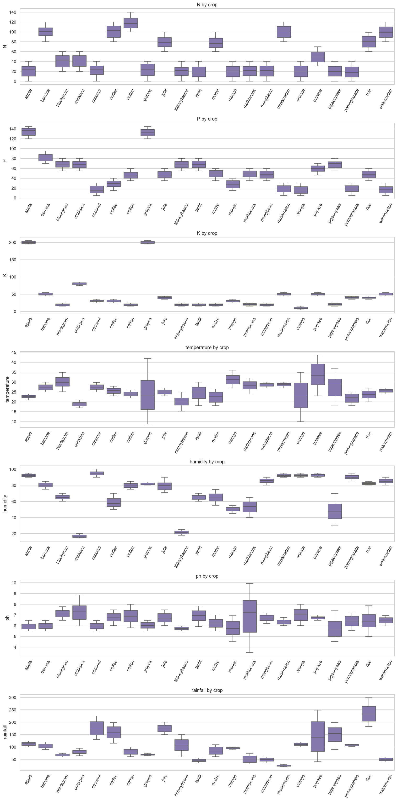
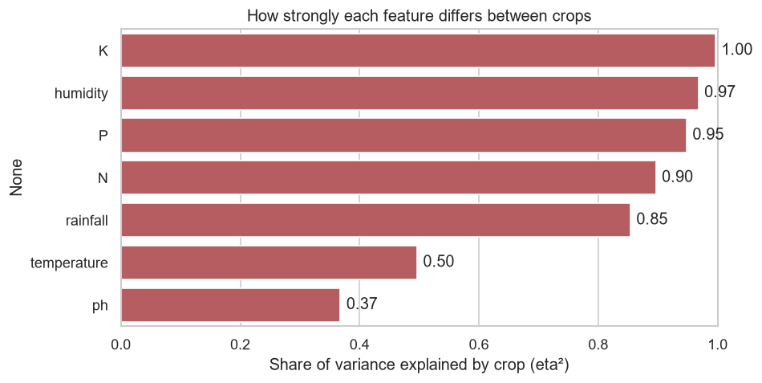
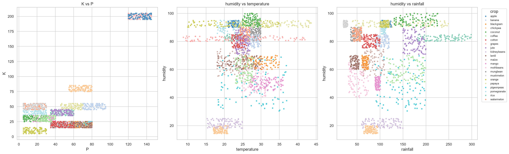
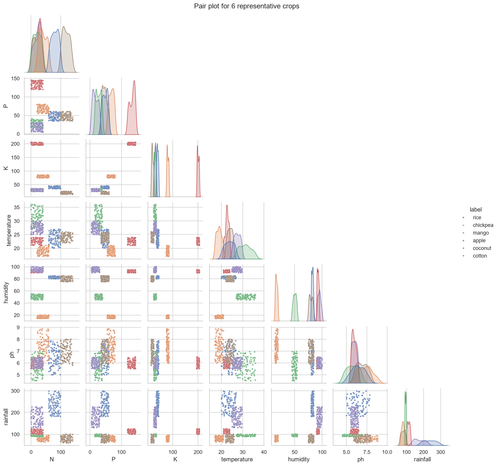

# EDA Report: Crop Recommendation Dataset

**Phase:** 2 (Exploratory Data Analysis)
**Dataset:** `data/Crop_recommendation.csv` (read-only, not modified)
**Notebook:** `notebooks/exploratory_analysis.ipynb`
**Figures:** `results/figures/`

---

## 1. What is this dataset?

Each row describes the growing conditions of one field sample and the crop that suits those conditions.

| Column | Type | Meaning | Unit / scale |
|---|---|---|---|
| N | integer | Nitrogen in soil | ratio (0–140) |
| P | integer | Phosphorus in soil | ratio (5–145) |
| K | integer | Potassium in soil | ratio (5–205) |
| temperature | decimal | Air temperature | °C |
| humidity | decimal | Relative humidity | % |
| ph | decimal | Soil acidity/alkalinity | pH (0–14 scale) |
| rainfall | decimal | Rainfall | mm |
| label | text | **Target**: recommended crop | 22 crop names |

- **Size:** 2,200 rows × 8 columns (7 input features + 1 target)
- **Task type:** multi-class classification (predict 1 of 22 crops)

---

## 2. Data quality

| Check | Result | Meaning |
|---|---|---|
| Missing values | **0** in every column | No gaps to fill |
| Fully duplicated rows | **0** | No repeated records |
| Same inputs with different labels | **0** | No conflicting examples |
| Negative N / P / K / rainfall | **0** | All physically valid |
| Humidity outside 0–100 % | **0** | Valid |
| pH outside 0–14 | **0** | Valid |
| Label text issues (extra spaces, mixed case) | **0** | 22 clean, lowercase labels |

**Unusual but plausible values (kept):**
- 27 rows with N = 0
- 10 rows with very acidic soil (pH < 4), 11 rows with very alkaline soil (pH > 9)
- 128 rows with very low humidity (< 20 %), all of them chickpea (100) and kidneybeans (28)

✅ **The dataset is clean.** It needs no cleaning.

---

## 3. Descriptive statistics

| Feature | Mean | Std | Min | 25 % | Median | 75 % | Max | Skew |
|---|---|---|---|---|---|---|---|---|
| N | 50.55 | 36.92 | 0.00 | 21.00 | 37.00 | 84.25 | 140.00 | 0.51 |
| P | 53.36 | 32.99 | 5.00 | 28.00 | 51.00 | 68.00 | 145.00 | 1.01 |
| K | 48.15 | 50.65 | 5.00 | 20.00 | 32.00 | 49.00 | 205.00 | **2.38** |
| temperature | 25.62 | 5.06 | 8.83 | 22.77 | 25.60 | 28.56 | 43.68 | 0.18 |
| humidity | 71.48 | 22.26 | 14.26 | 60.26 | 80.47 | 89.95 | 99.98 | **−1.09** |
| ph | 6.47 | 0.77 | 3.50 | 5.97 | 6.43 | 6.92 | 9.94 | 0.28 |
| rainfall | 103.46 | 54.96 | 20.21 | 64.55 | 94.87 | 124.27 | 298.56 | 0.97 |

**In plain words:**
- **Skew** tells you if a feature has a long tail. Positive means a few very large values, negative means a few very small ones.
- **K** has a strong right tail. Most samples are below 50, but two crops sit near 200.
- **humidity** has a left tail. Most samples are humid (median 80 %), and a few are very dry.
- The features use **very different scales**: pH spans about 6 units, while rainfall spans about 280 mm.

---

## 4. Target: crop distribution

- **22 crops:** apple, banana, blackgram, chickpea, coconut, coffee, cotton, grapes, jute, kidneybeans, lentil,
  maize, mango, mothbeans, mungbean, muskmelon, orange, papaya, pigeonpeas, pomegranate, rice, watermelon
- **Each crop has exactly 100 rows (4.55 %).**

✅ The dataset is **perfectly balanced**, so no resampling is needed and accuracy is a fair metric.

---

## 5. Feature distributions

### 5.1 Histograms

- N, P and K have **several peaks** (multi-modal), because different crop groups need very different amounts of each nutrient.
- P and K have a separate cluster at very high values (P ≈ 120–145, K ≈ 195–205).
- temperature and pH are roughly bell-shaped.

### 5.2 Boxplots and outliers

Outliers counted with the IQR rule (beyond 1.5 × interquartile range):

| Feature | Outliers | % | Main crops involved |
|---|---|---|---|
| N | 0 | 0.00 | – |
| P | 138 | 6.27 | apple, grapes |
| K | 200 | 9.09 | grapes, apple |
| temperature | 86 | 3.91 | papaya, grapes, orange |
| humidity | 30 | 1.36 | chickpea |
| ph | 57 | 2.59 | mothbeans, chickpea, mango |
| rainfall | 100 | 4.55 | rice, papaya, coconut |

⚠️ **These outliers are real crop characteristics, not errors.** For example, all 200 K outliers are the
apple and grapes samples. Removing them would erase what makes those crops recognizable.

---

## 6. Correlation between features

| Pair | r |
|---|---|
| P – K | **0.74** |
| N – P | −0.23 |
| temperature – humidity | 0.21 |
| K – humidity | 0.19 |
| N – humidity | 0.19 |

- Only **P and K** are strongly related, mostly because apple and grapes are high in both.
- Every other pair is weak (|r| < 0.25).
- No pair is above 0.8, so **no feature is redundant**.

---

## 7. How features differ between crops

### 7.1 Average conditions per crop

Each crop has a recognizable "fingerprint":

| Pattern | Crops |
|---|---|
| Very high P (~130) and K (~200) | apple, grapes |
| Highest rainfall (~236 mm) | rice; also coconut, jute (~175 mm) |
| Very dry (humidity ~17–22 %) | chickpea, kidneybeans |
| High nitrogen (~100–118) | cotton, coffee, banana, muskmelon, watermelon |
| Hottest (~31–34 °C) | papaya, mango |
| Coolest (~19 °C) | chickpea |
| Very low rainfall (~25 mm) | muskmelon |

### 7.2 Feature ranges per crop

Most crops occupy **narrow, distinct ranges** for several features. pH overlaps most between crops.

### 7.3 Which features separate crops best?

**Eta² (eta-squared)** is the share of a feature's variation that is explained by the crop label.
It runs from 0 to 1, and higher means the feature tells crops apart better. No model is trained to get this number.

| Feature | eta² | Strength |
|---|---|---|
| K | 1.00 | very strong |
| humidity | 0.97 | very strong |
| P | 0.95 | very strong |
| N | 0.90 | strong |
| rainfall | 0.85 | strong |
| temperature | 0.50 | moderate |
| ph | 0.37 | weaker |

Even the weaker features help when they are combined with the others.

### 7.4 Scatter plots of key pairs

- **P vs K:** apple and grapes form an isolated cluster at the top right, and chickpea forms its own band (K ≈ 75–85).
- **humidity vs temperature / rainfall:** chickpea and kidneybeans sit apart at low humidity, and rice stands out at high rainfall.
- Some pulses (lentil, blackgram, mothbeans, mungbean) overlap in 2D, but they should separate once all 7 features are used.

### 7.5 Pair plot (6 representative crops)

---

## 8. Key observations

1. **Clean data:** no missing values, duplicates or invalid entries.
2. **Perfectly balanced target:** 22 classes × 100 samples.
3. **Strongly separable classes:** most features differ sharply between crops, so a high classification accuracy is likely.
4. **Outliers are meaningful.** They mark specific crops, so keep them.
5. **Only one notable correlation (P–K, 0.74).** All 7 features are worth keeping.
6. **Features use very different scales,** which matters for distance-based and linear models.
7. **The data likely comes from a generator.** Many crops form neat rectangular blocks with values spread evenly inside fixed limits, which suggests the dataset was synthetically generated or augmented from per-crop ranges. Expect very high test accuracy, but real-world field data would be noisier.

---

## 9. Recommendations for preprocessing (Phase 3)

| # | Step | Why |
|---|---|---|
| 1 | **No cleaning or imputation** | There are no missing, duplicate or invalid values |
| 2 | **Keep all outliers** | They are genuine crop characteristics |
| 3 | **Keep all 7 features** | None is redundant |
| 4 | **Separate X (7 features) and y (`label`)** | Standard supervised-learning setup |
| 5 | **Encode the target** with `LabelEncoder`, and save the encoder | The model needs numeric labels, and the encoder turns predictions back into crop names |
| 6 | **Stratified train/test split** (e.g. 80/20, `stratify=y`, fixed `random_state`) | Keeps every crop equally represented in both sets and makes results reproducible |
| 7 | **Scale features** with `StandardScaler`, fitted on the training set only | Needed for Logistic Regression, KNN and SVM. Fitting only on training data prevents data leakage. Tree models don't need scaling but aren't hurt by it |
| 8 | **Save the scaler** alongside the model | The Streamlit app must apply the same scaling to user inputs |
| 9 | *(Optional)* log-transform K and rainfall for linear models | Reduces skew; not needed for tree models |
| 10 | **Evaluate with** accuracy, per-class precision/recall/F1, a confusion matrix and cross-validation | Accuracy is fair because the classes are balanced. Cross-validation checks that a near-perfect score is stable |

---

## 10. Figures generated

| File | Content |
|---|---|
| `figures/01_crop_distribution.png` | Samples per crop |
| `figures/02_feature_histograms.png` | Histograms + density of all 7 features |
| `figures/03_feature_boxplots.png` | Boxplots of all 7 features |
| `figures/04_correlation_heatmap.png` | Feature correlation matrix |
| `figures/05_crop_feature_means_heatmap.png` | Mean of each feature per crop |
| `figures/06_features_by_crop_boxplots.png` | Each feature's distribution per crop |
| `figures/07_feature_separation_eta_squared.png` | How well each feature separates crops |
| `figures/08_scatter_key_feature_pairs.png` | P–K, temperature–humidity, rainfall–humidity scatter plots |
| `figures/09_pairplot_sample_crops.png` | Pair plot for 6 representative crops |
