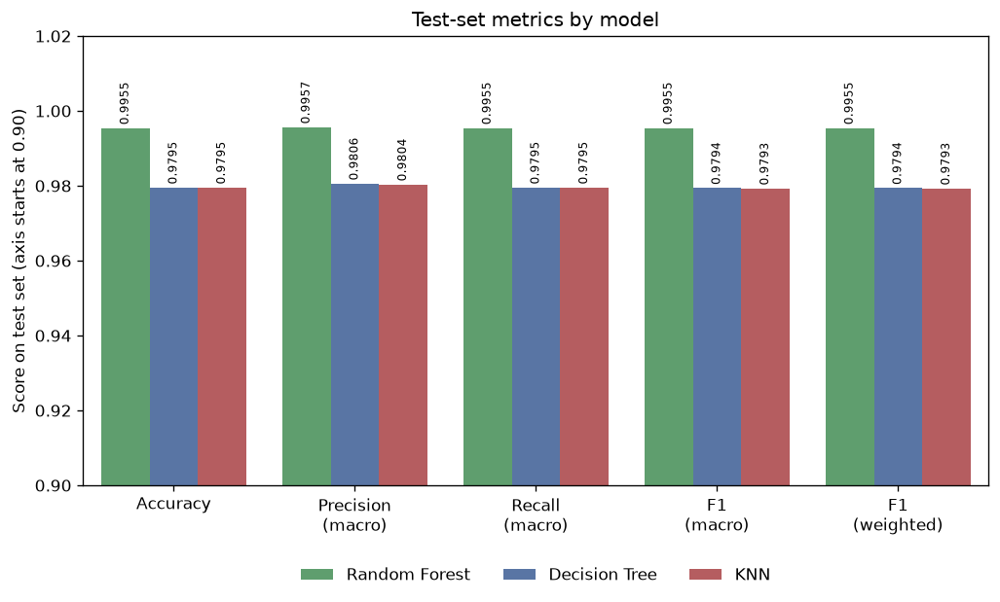
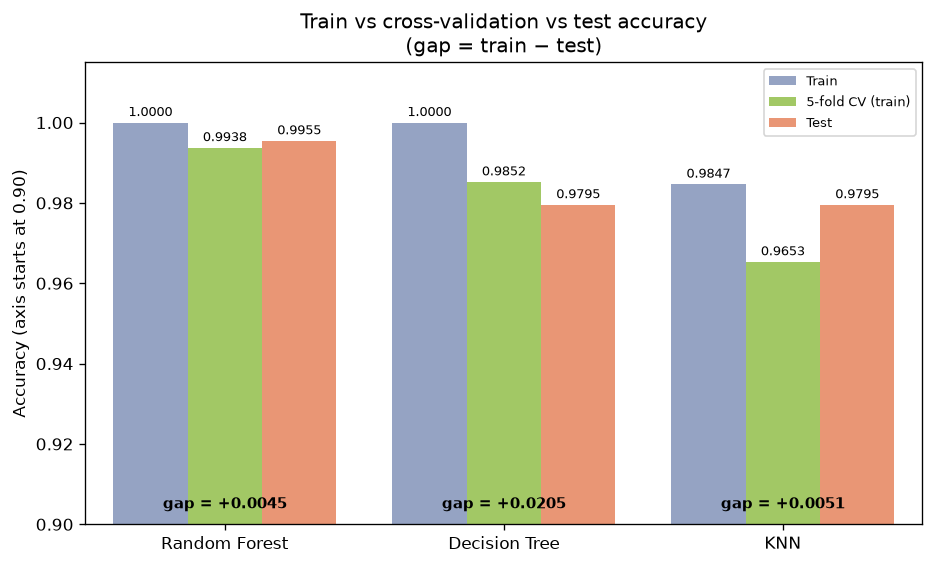
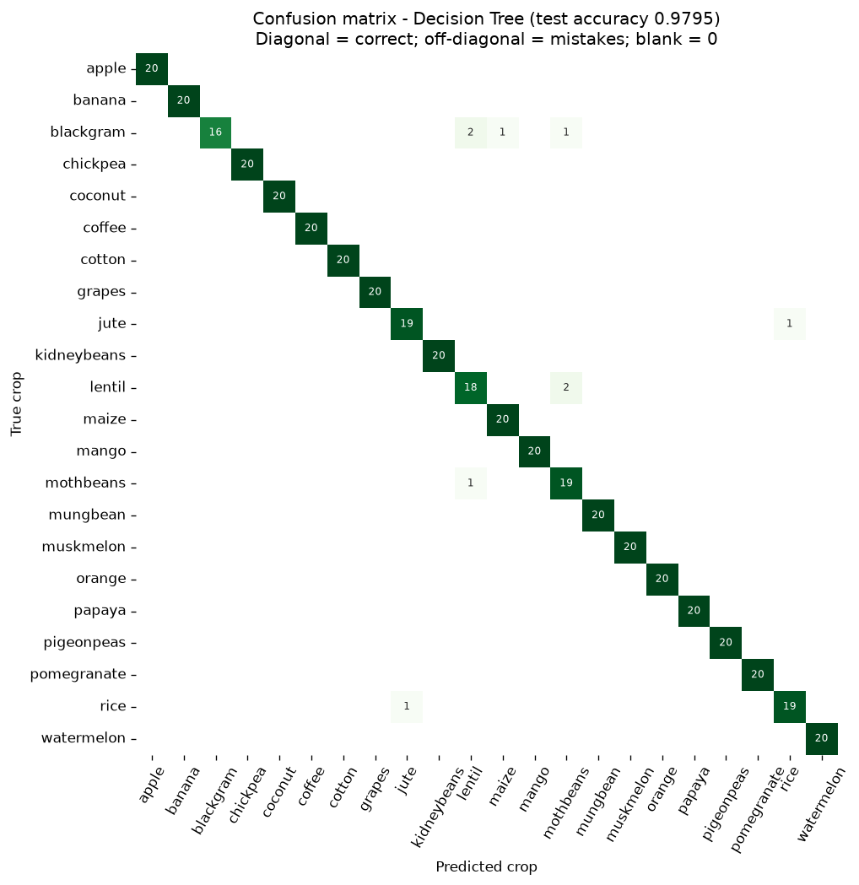
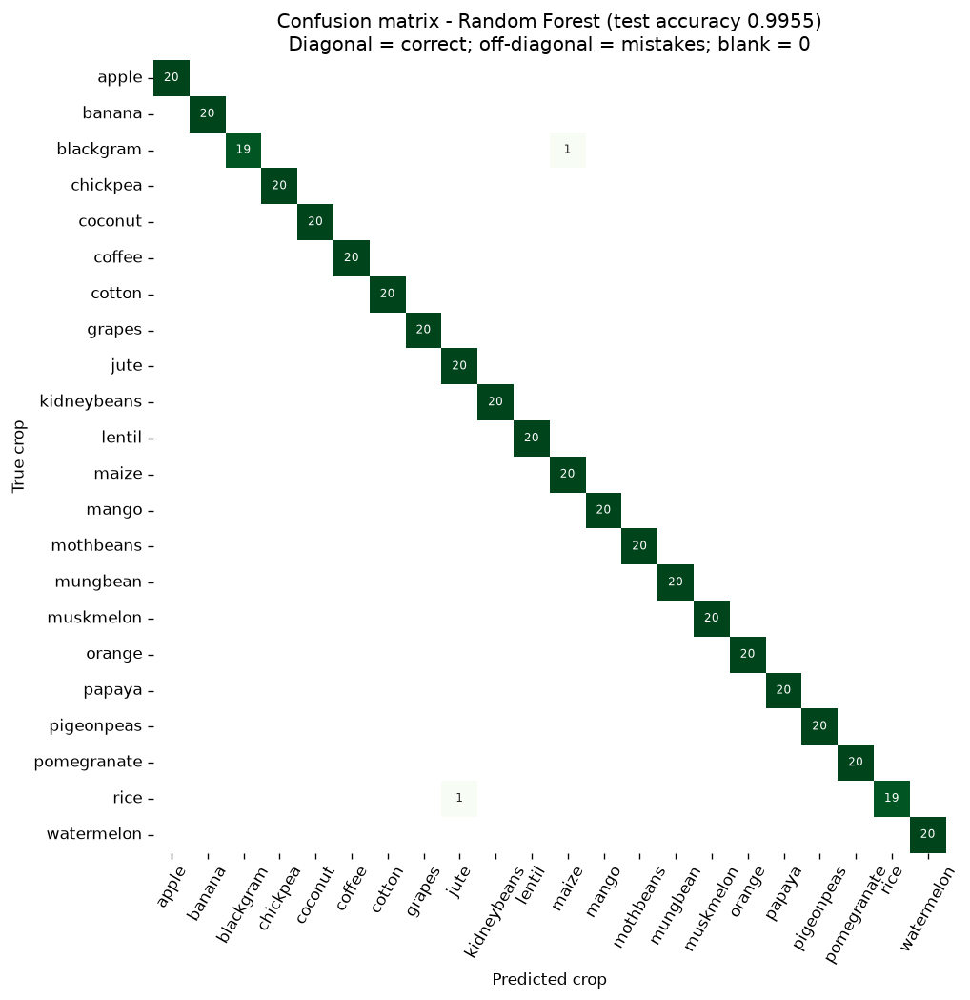
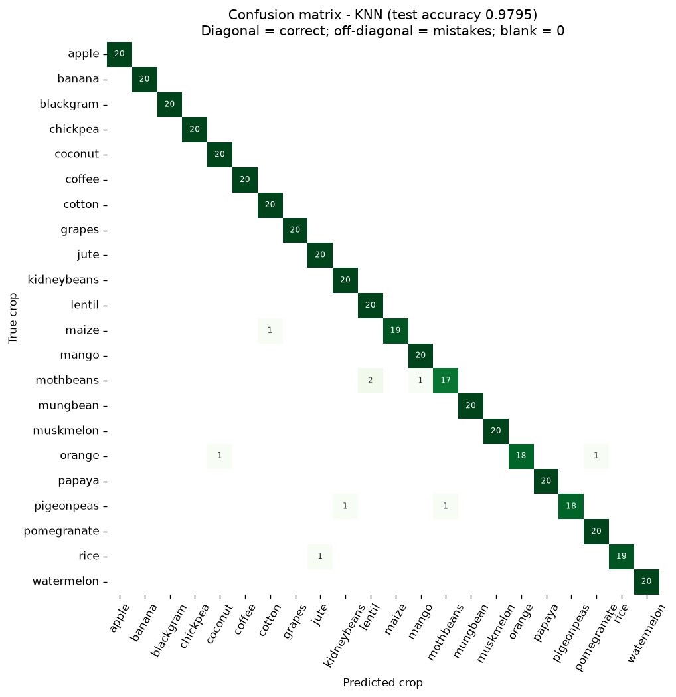
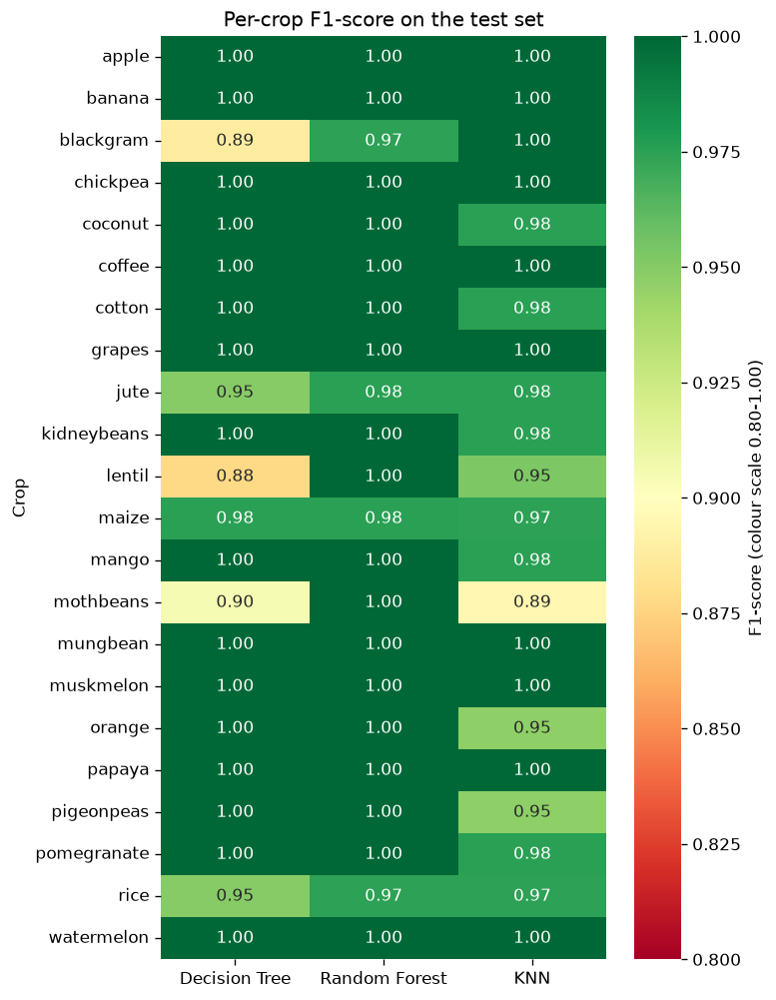
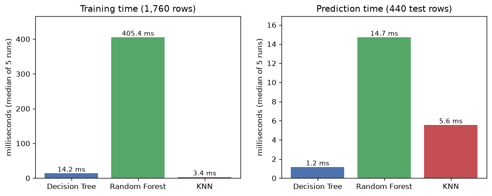

# Model Evaluation Report: Crop Recommendation

*This file is generated by `python -m src.evaluate`. Every number comes from the saved models evaluated on the saved test set.*

## 1. Setup

| Item | Value |
|---|---|
| Test set | 440 rows (20 per crop × 22 crops), never used for training |
| Training set | 1,760 rows (80 per crop) |
| Split | stratified 80/20, `random_state=42` (from Phase 3) |
| Models | Decision Tree, Random Forest (unscaled input); KNN, k = 5 (scaled input) |
| Cross-validation | 5-fold stratified, on the **training set only** |
| Overfitting rule | flagged if train accuracy − test accuracy > 0.02 |

## 2. What the metrics mean

| Metric | Plain-language meaning |
|---|---|
| **Accuracy** | Share of test samples predicted correctly. |
| **Precision** | Of the samples the model labelled as crop X, how many really were X. Low precision means false alarms. |
| **Recall** | Of the real X samples, how many the model found. Low recall means missed cases. |
| **F1-score** | Harmonic mean of precision and recall; high only if both are high. |
| **Macro average** | Average over the 22 crops, every crop counted equally. |
| **Weighted average** | Average weighted by how many samples each crop has. The test set is perfectly balanced, so macro and weighted give almost the same values here. |
| **Confusion matrix** | Table of true crop (rows) vs predicted crop (columns). The diagonal holds correct predictions. |
| **Generalization gap** | Train accuracy − test accuracy. A large positive gap means the model memorised training data (overfitting). |
| **Cross-validation (CV)** | Train/validate 5 times on different parts of the training set. Gives a more stable estimate than one test split. |

## 3. Results

### 3.1 Test-set metrics

| Rank | Model | Accuracy | Precision (macro) | Recall (macro) | F1 (macro) | F1 (weighted) | Errors / 440 |
|---|---|---|---|---|---|---|---|
| 1 | Random Forest | 0.9955 | 0.9957 | 0.9955 | 0.9955 | 0.9955 | 2 |
| 2 | Decision Tree | 0.9795 | 0.9806 | 0.9795 | 0.9794 | 0.9794 | 9 |
| 3 | KNN | 0.9795 | 0.9804 | 0.9795 | 0.9793 | 0.9793 | 9 |

### 3.2 Train vs test: overfitting check

| Model | Train acc. | 5-fold CV acc. (mean ± std) | Test acc. | Gap (train − test) | Overfitting? |
|---|---|---|---|---|---|
| Random Forest | 1.0000 | 0.9938 ± 0.0061 | 0.9955 | +0.0045 | No |
| Decision Tree | 1.0000 | 0.9852 ± 0.0068 | 0.9795 | +0.0205 | Yes |
| KNN | 0.9847 | 0.9653 ± 0.0121 | 0.9795 | +0.0051 | No |

**How to read this:**
- **Random Forest** fits the training data perfectly (100 %). On unseen data it scores 0.9955, a gap of +0.0045. This is within the threshold, so it is not flagged as overfitting.
- **Decision Tree** fits the training data perfectly (100 %). On unseen data it scores 0.9795, a gap of +0.0205. This is just above the threshold: **slight overfitting**. A single unpruned tree memorises its training rows; limiting depth or using an ensemble reduces this.
- **KNN** does not memorise the training data (0.9847); the gap is +0.0051. This is within the threshold, so it is not flagged as overfitting.
- Cross-validation accuracy is within 0.0142 of the test accuracy for every model, so the single test split is not a lucky split. (In each CV fold the model trains on only 80 % of the training set, so CV accuracy can be slightly lower.)

### 3.3 Confusion matrices

**Decision Tree**

**Random Forest**

**KNN**

Most common mistakes (true → predicted):

| Model | Mistakes |
|---|---|
| Random Forest | rice → jute (1), blackgram → maize (1) |
| Decision Tree | lentil → mothbeans (2), blackgram → lentil (2), mothbeans → lentil (1), rice → jute (1), jute → rice (1) |
| KNN | mothbeans → lentil (2), mothbeans → mango (1), orange → pomegranate (1), maize → cotton (1), rice → jute (1) |

### 3.4 Per-crop F1-score

Crops with F1 below 1.00 for at least one model:

| Crop | Decision Tree | Random Forest | KNN |
|---|---|---|---|
| blackgram | 0.889 | 0.974 | 1.000 |
| coconut | 1.000 | 1.000 | 0.976 |
| cotton | 1.000 | 1.000 | 0.976 |
| jute | 0.950 | 0.976 | 0.976 |
| kidneybeans | 1.000 | 1.000 | 0.976 |
| lentil | 0.878 | 1.000 | 0.952 |
| maize | 0.976 | 0.976 | 0.974 |
| mango | 1.000 | 1.000 | 0.976 |
| mothbeans | 0.905 | 1.000 | 0.895 |
| orange | 1.000 | 1.000 | 0.947 |
| pigeonpeas | 1.000 | 1.000 | 0.947 |
| pomegranate | 1.000 | 1.000 | 0.976 |
| rice | 0.950 | 0.974 | 0.974 |

Full per-crop reports are in `results/metrics/classification_report_<model>.csv`.

### 3.5 Speed

| Model | Training time | Prediction time (440 rows) |
|---|---|---|
| Decision Tree | 14.2 ms | 1.2 ms |
| Random Forest | 405.4 ms | 14.7 ms |
| KNN | 3.4 ms | 5.6 ms |

All models are fast enough for an interactive app. KNN trains almost instantly because it only stores the data; its work happens at prediction time.

## 4. Best model

**Selection rule** (fixed before looking at results): highest test macro F1 → highest CV accuracy → smallest generalization gap → fastest prediction.

### Selected: **Random Forest**

- Test accuracy **0.9955** (2 errors out of 440)
- Macro F1 **0.9955**, macro precision 0.9957, macro recall 0.9955
- 5-fold CV accuracy 0.9938 ± 0.0061
- Generalization gap +0.0045

Runner-up: **Decision Tree** (macro F1 0.9794, 9 errors). The difference is 0.0160 macro F1, i.e. 7 fewer mistakes on 440 test samples.

The saved choice is in `models/best_model.json`; the prediction pipeline and the app read it from there.

## 5. Key findings

1. All three models score very high on unseen data. This matches the EDA: crops have distinct, well-separated feature ranges.
2. Errors concentrate on a few crop pairs with overlapping conditions (see confusion tables). Most crops are predicted perfectly.
3. Train accuracy alone is misleading: the tree models score 100 % on training data. Only the test set and cross-validation show real performance.
4. Because the test set is balanced, macro and weighted averages are nearly equal; accuracy is a fair summary metric.
5. The EDA suggested the dataset is likely synthetic/augmented. Scores this high should not be expected on noisy real-world farm data without further validation.

## 6. Data leakage safeguards

- The test set was split off before scaling, and was never used to fit the scaler, models, or select hyper-parameters.
- The scaler was fitted on the training set only.
- Cross-validation for KNN re-fits the scaler inside each fold (scikit-learn pipeline).
- Model selection uses a rule fixed in code; no settings were tuned on the test set.

## 7. Files

| File | Content |
|---|---|
| `results/metrics/evaluation_results.json` / `.csv` | All metrics per model, ranked |
| `results/metrics/classification_report_<model>.csv` | Per-crop precision / recall / F1 |
| `results/metrics/confusion_matrix_<model>.csv` | Confusion matrices as tables |
| `results/metrics/per_class_f1.csv` | Per-crop F1 for all models |
| `models/best_model.json` | Selected model and its metrics |
| `results/figures/11-17_*.png` | Charts in this report |
